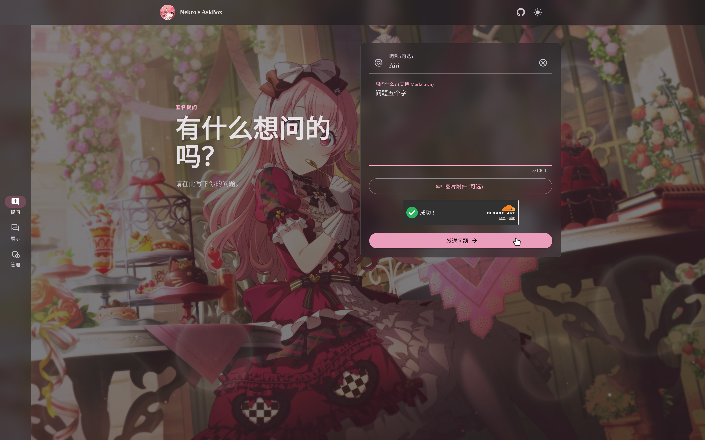
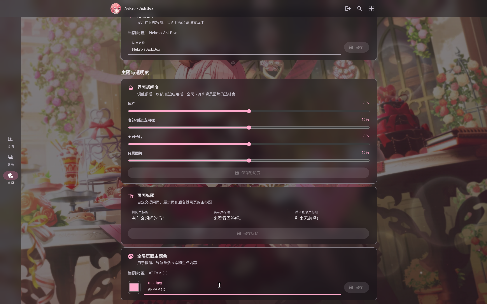
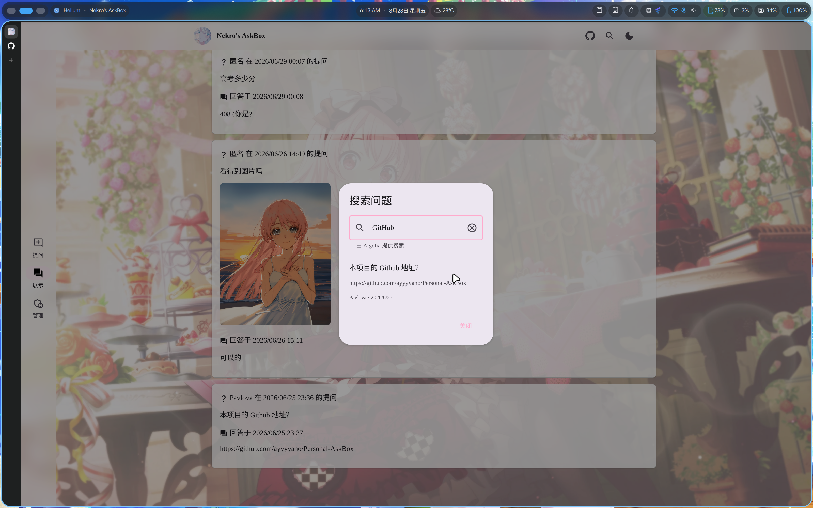

# 个人提问箱


一个可以直接上线使用的匿名提问箱网站，适合放在个人主页、博客、社交资料页里收集匿名问题。

## 预览

| 提问页 | 管理后台 | 搜索页面 |
|--------|----------|----------|
|  |  |  |

**DEMO:** https://askbox.nekro.top/

## 技术栈

| 组件 | 当前版本或用途 |
|------|----------------|
| Node.js | 22.13+（22.x）或 24+ |
| pnpm | 12.15.0 |
| Next.js | 16.4.5，App Router |
| React / React DOM | 19.3.1 |
| TypeScript | 6.0.3 |
| ESLint | 10.14.0 |
| OpenNext for Cloudflare | 1.20.16 |
| Wrangler | 4.157.0 |
| MDUI | 2.1.5 |
| Cloudflare | Workers、D1、KV、R2、Turnstile |
| Algolia | 5.61.0，可选搜索 |

完整依赖及精确版本以 `package.json` 和 `pnpm-lock.yaml` 为准。项目在 `packageManager` 中固定 pnpm 12.15.0，安装依赖时使用 `pnpm install --frozen-lockfile`。

首次使用时安装 pnpm，再安装项目依赖：

```bash
npm install --global pnpm@12.15.0
pnpm install --frozen-lockfile
```

`pnpm-workspace.yaml` 允许 esbuild、unrs-resolver 和 workerd 执行安装脚本，用于准备构建工具及本地 Workers 运行时。新增需要执行安装脚本的依赖时，先检查脚本内容，再更新许可。

项目使用 `nodeLinker: hoisted`，避免 Windows 下 OpenNext 复制依赖后出现符号链接访问错误。依赖版本仍由 `pnpm-lock.yaml` 锁定。

### 依赖兼容与已知提示

TypeScript 使用 6.0.3，匹配 `typescript-eslint` 的支持范围（`>=4.8.4 <6.1.0`）。路径别名由 `paths` 配置，省略 TypeScript 6 已弃用的 `baseUrl`。

`pnpm-workspace.yaml` 中有两项定向版本覆盖：

- `@node-minify/core@9.0.2` 的 glob 使用 13.0.6，替换已弃用的 10.3.3。测试覆盖 `globSync` 的字符串、数组匹配及 JavaScript 压缩。
- esbuild 0.28.2 暂用 0.28.1。本项目的 Windows 对照测试中，0.28.2 内存构建成功但写文件被拒绝，0.28.1 写文件正常。升级时应运行落盘回归测试及 `cf:build`，再评估解除覆盖。

安装时仍可能出现以下上游提示：

- `node-domexception@1.0.0` 弃用：由 `@opennextjs/cloudflare → cloudflare@4.5.0 → formdata-node@4.4.1` 引入，需要等待上游替换这一依赖。
- ESLint peer 版本提示：`eslint-plugin-react`、`eslint-plugin-import`、`eslint-plugin-jsx-a11y` 尚未声明支持 ESLint 10。[Next.js 文档](https://nextjs.org/docs/app/api-reference/config/eslint) 已列出 16.4 对 ESLint 10 的支持及这些插件提示；更新依赖后仍需运行 `pnpm run lint`。
- OpenNext 的 Windows 兼容性提示。需要在 Linux 环境复验时，可使用 WSL 或 CI。

## 使用 Agent 辅助部署

Agent 可以检查公开配置、生成部署命令和运行本地构建。账号登录、密钥录入、远端数据库初始化和部署由部署者在自己的终端中完成。

以下内容属于敏感信息：`SESSION_SECRET`、`ADMIN_PASSWORD`、`TURNSTILE_SECRET_KEY`、`ALGOLIA_ADMIN_API_KEY`、Cloudflare API Token，以及保存在 `.env`、`.env.local` 或密码管理器中的其他凭据。敏感值应通过 Wrangler 的交互式提示录入，不应出现在 Agent 对话、命令参数、管道、日志或截图中。

向第三方或云端 Agent 提供项目时，应使用不含私密文件的干净仓库副本。副本中不要复制 `.env`、`.env.local`、`.env*.local`、`.wrangler/`、数据库备份、日志和凭据文件。如果不希望公开 Cloudflare 资源 ID，也应先将副本中 `wrangler.jsonc` 的对应值替换为占位符。`.gitignore` 只影响 Git 的文件跟踪行为，不能限制 Agent 或构建工具读取本地文件。

可将以下提示发送给 Agent：

```text
这个工作区是不含环境文件、凭据、备份和日志的部署副本。检查项目部署到 Cloudflare Workers 所需的公开配置。
你可以读取 README.md、package.json、wrangler.jsonc 和 .env.example，运行 lint、类型检查和本地构建。
不要访问项目目录之外的文件、凭据存储或 shell 历史记录。
使用占位符列出需要我在本地终端执行的 Wrangler 登录、资源创建、secret put、远端数据库初始化和部署命令。
在执行会修改 Cloudflare、D1、KV、R2 或 Algolia 的命令前停止，并等待我自行执行。
不要索取、显示或保存密码、Session 密钥、Turnstile 密钥、Algolia Admin API Key 或 Cloudflare API Token。
```

Agent 完成本地检查后，按照下方[手动部署](#手动部署)步骤创建资源并部署。`wrangler secret put` 不带密钥参数运行，按终端提示输入敏感值：

```bash
pnpm exec wrangler secret put SESSION_SECRET
pnpm exec wrangler secret put ADMIN_PASSWORD
pnpm exec wrangler secret put TURNSTILE_SECRET_KEY
```

`.env.local` 已在 `.gitignore` 中排除。提交前使用 `git diff --cached --name-only` 检查将要提交的文件，确认其中没有环境文件、备份、日志或凭据。当前 `cf:deploy` 脚本固定使用 `askbox.nekro.top` 自定义域名；部署到其他域名或 `workers.dev` 前需调整 `package.json` 中的部署脚本。

如果敏感值曾被发送到 Agent、聊天服务或公开日志，请在对应服务中撤销并重新生成这些凭据。删除聊天记录不能替代凭据轮换。

> **搜索功能（可选）** 需要额外的 Algolia 配置，详见下方 [Algolia 搜索配置](#algolia-搜索配置可选)。

## 手动部署

### 前置准备

- Node.js 22.13+（22.x）或 24+
- pnpm 12.15.0
- [Wrangler](https://developers.cloudflare.com/workers/wrangler/) 已登录：`pnpm exec wrangler login`
- 一个 [Cloudflare](https://dash.cloudflare.com) 账号

### 1. 本地配置

```bash
cp .env.example .env.local
```

编辑 `.env.local`：

```env
SITE_NAME="个人提问箱"
# 当前版本的站点名称请在 /admin/settings 中修改；此变量为旧版本遗留配置
SESSION_SECRET="换成一段很长的随机字符串"
# 本地测试可使用 admin；实际部署前必须替换为自定义强密码
ADMIN_PASSWORD="admin"
NEXT_PUBLIC_TURNSTILE_SITE_KEY=""
TURNSTILE_SECRET_KEY=""
```

本地开发时，如果没有配置 `ADMIN_PASSWORD`，管理员登录也会使用初始密码 **`admin`**。访问 `/admin` 即可测试登录流程。实际部署时请务必设置自定义强密码，不能使用此默认密码。

### 2. 创建 Cloudflare 资源

```bash
pnpm exec wrangler d1 create askbox-db              # D1 数据库
pnpm exec wrangler kv namespace create ASKBOX_KV     # KV 命名空间
pnpm exec wrangler r2 bucket create askbox-uploads   # R2 存储桶
```

将输出中的 `database_id` 和 `id` 填入 `wrangler.jsonc`。

### 3. 初始化数据库

```bash
pnpm run db:local   # 本地 D1
pnpm run db:remote  # 远端 D1（必须执行）
```

### 4. 设置生产密钥

```bash
pnpm exec wrangler secret put SESSION_SECRET
pnpm exec wrangler secret put ADMIN_PASSWORD
pnpm exec wrangler secret put TURNSTILE_SECRET_KEY
```

Wrangler 会依次提示输入密钥。请直接在提示中输入，不要把密钥放进命令参数或 shell 管道。

> 开发模式 Turnstile 可留空；生产环境请务必在 Cloudflare Dashboard 创建 Turnstile widget 并填入密钥。

### 5. 构建并部署

```bash
pnpm run cf:deploy
```

部署成功后会输出 `https://xxx.workers.dev` 访问地址。

## 已有项目的手动更新与迁移

以下流程适用于已经上线、需要同步新代码或数据库结构的项目。默认先备份远端 D1，再执行迁移，最后部署 Worker。只更新前端或 Worker 代码时，可以跳过数据库迁移步骤。

### 1. 同步代码并检查工作区

```bash
git fetch origin
git pull --ff-only origin main
pnpm install --frozen-lockfile
pnpm exec wrangler whoami
```

确认当前分支和提交正确，并确认 Wrangler 登录的是拥有目标 Worker、D1、KV 和 R2 资源的 Cloudflare 账号。

### 2. 备份远端 D1

在执行任何远端迁移前保存一份 SQL 备份：

```bash
pnpm exec wrangler d1 export askbox-db --remote --output="./backup/askbox-$(date +%Y%m%d-%H%M%S).sql"
```

备份文件包含问答数据、站点设置和数据库结构。请将 `backup/` 加入 `.gitignore`，不要把备份文件提交到仓库或公开上传。

如只想先确认数据规模，也可以执行只读查询：

```bash
pnpm exec wrangler d1 execute askbox-db --remote --command="SELECT COUNT(*) AS question_count FROM questions; SELECT status, COUNT(*) AS count FROM questions GROUP BY status ORDER BY status; SELECT COUNT(*) AS site_settings_count FROM site_settings;"
```

### 3. 应用版本化迁移

先查看本地迁移文件，再按顺序应用尚未执行的迁移：

```bash
ls migrations
pnpm exec wrangler d1 migrations list askbox-db --remote
pnpm exec wrangler d1 migrations apply askbox-db --remote
```

本仓库当前的迁移包括：

- `0002_add_site_appearance.sql`：添加主题色和顶栏、应用栏、卡片透明度字段
- `0003_add_background_opacity.sql`：添加背景图片透明度字段
- `0004_add_logo_settings.sql`：添加 Logo 地址及顶栏图片显示模式字段

不要使用 `pnpm run db:remote` 代替版本化迁移。该命令执行完整 `db/schema.sql`，适合首次初始化；已有项目更新数据库结构时应使用 `db:migrate:remote`，避免把初始化流程和版本迁移混在一起。

本地验证迁移可使用：

```bash
pnpm exec wrangler d1 migrations apply askbox-db --local
```

### 4. 构建并部署 Worker

```bash
pnpm run cf:build
pnpm run cf:deploy
```

`cf:deploy` 会先构建 OpenNext 产物，再部署 `personal-askbox`，并使用 `package.json` 中配置的域名。部署前如需确认只进行构建，可只执行 `pnpm run cf:build`。

只检查部署打包、不上传或发布时，在构建完成后执行：

```bash
pnpm exec wrangler deploy --dry-run --outdir .wrangler/deploy-check
```

若使用 Cloudflare Workers Builds，保留 `pnpm-lock.yaml`，让平台选择 pnpm，并通过 `packageManager` 固定版本；构建命令使用 `pnpm run cf:build`。如需自行控制冻结安装，可设置构建变量 `SKIP_DEPENDENCY_INSTALL=1`，再将构建命令设为 `pnpm install --frozen-lockfile && pnpm run cf:build`。详见 [Workers Builds 构建环境文档](https://developers.cloudflare.com/workers/ci-cd/builds/build-image/#package-manager-versions)。本地 `--dry-run` 不会更新 Cloudflare 后台的构建配置。

### 5. 上线后验证

至少检查以下路径和功能：

```bash
curl -I https://你的域名/
curl -I https://你的域名/display
curl -I https://你的域名/search?q=test
```

然后人工确认：提问表单、人机验证、后台登录、回答发布、背景图片、搜索对话框和移动端导航。确认无误后再清理旧的本地备份；问答数据不会因 Worker 部署而被删除。

根路径应直接返回 `200` 和 `X-Askbox-Delivery: static-root`。旧路径 `/ask`、`/display`、`/search` 应返回一次 `308`，跳转到根页面。UptimeFlare 等 HTTP 监控应检查 `/` 的 `200` 响应；HEAD 检查验证页面交付，不能验证 JavaScript、D1、提问提交或 Turnstile 的可用性。

### D1 权限或账号错误排查

如果迁移出现 `The given account is not valid or is not authorized to access this service [code: 7403]`，按以下顺序检查：

1. 执行 `pnpm exec wrangler whoami`，确认登录账号正确。
2. 确认 `wrangler.jsonc` 中的 `account_id` 与目标 D1 所属账号一致。
3. 确认 API Token 具有目标账号的 D1 编辑权限，以及 Workers 部署权限。
4. 确认命令中的数据库名和 `database_id` 对应同一个 D1 数据库。
5. 重新登录后再执行 `pnpm exec wrangler d1 migrations apply askbox-db --remote`。

这类错误通常是账号、Token 权限或资源归属不一致，不是迁移 SQL 本身的问题。若远端迁移已执行成功，不要重复运行旧迁移；先用 `pnpm exec wrangler d1 migrations list askbox-db --remote` 确认状态。

## 功能特性

- **匿名提问**：支持公开昵称或匿名留言，可附带图片附件（PNG/JPG/WebP/GIF）
- **全文搜索**：基于 Algolia 的实时搜索，前台搜公开问题，后台搜全部（**可选功能**，见下方配置）
- **人机验证**：集成 Cloudflare Turnstile 验证，防止垃圾提交
- **深色模式**：顶部按钮一键切换浅色/深色/跟随系统，选择自动持久化
- **响应式导航与页面过渡**：桌面端使用左侧导航栏，移动端使用底部导航栏，站内页面切换采用客户端过渡动画，并尊重系统减少动态效果设置
- **管理后台**：登录后从后台主页进入问题列表和自定义设置；问题列表按状态分类（待回答/已回答/已展示/全部），支持回答、发布、删除问题，关联附件同步清理
- **限速保护**：同一 IP 每小时最多提交 **20** 个问题，超出限制返回提示
- **Markdown 支持**：问题和回答均支持 Markdown 语法，含加粗、斜体、链接、列表等，自动渲染为规范格式
- **快速复制**：点击公开展示页问答卡片一键复制问答内容，Snackbar 提示已复制
- **自定义 404 页面**：不存在的路径显示统一风格页面，并提供返回提问页入口

问题、回答和搜索结果在渲染时使用 `sanitize-html` 过滤 HTML。加粗、列表、表格、代码块及禁用状态的任务复选框可以正常显示，脚本、事件属性、内嵌 SVG、iframe 和自定义样式会被移除。链接支持 HTTP、HTTPS、mailto 和相对路径，图片支持 HTTP、HTTPS 和相对路径；`javascript:`、`data:` 等协议及 `//` 开头的地址会被过滤。历史内容也经过相同处理，数据库保留用户提交的原文。

## 页面与路由

| 路径 | 用途 | 访问权限 |
|------|------|----------|
| `/` | 默认提问视图，支持昵称、Markdown、图片附件和人机验证 | 公开 |
| `/#display` | 同一页面内查看已回答并公开的问题 | 公开 |
| `/?q=关键词#display` | 打开公开搜索对话框 | 公开 |
| `/ask`、`/display`、`/search?q=关键词` | 兼容旧链接，308 跳转到对应根页面视图 | 公开 |
| `/admin` | 管理员登录；登录后进入后台主页 | 登录后显示管理菜单 |
| `/admin/questions` | 查看、回答、发布或删除问题 | 需要管理员登录 |
| `/admin/settings` | 修改站点信息、首页提问文案和视觉设置 | 需要管理员登录 |
| `/terms` | 查看用户协议 | 公开 |
| `/privacy` | 查看隐私政策 | 公开 |
| 其他不存在路径 | 自定义 404 页面 | 公开 |

管理后台和公共页面共用“提问、展示、管理”主导航。后台主页另提供“问题列表”和“自定义设置”入口。

公共视图通过 URL hash 切换，支持浏览器前进、后退。切换时提问表单保持挂载，正文、昵称和已选附件会保留。公开问答首次进入展示视图时加载，同一次页面访问内复用结果；刷新页面可读取新发布的内容。

### 公共页面与 Workers 执行

`pnpm run cf:build` 在 OpenNext 构建后检查 `/` 的静态预渲染结果，并将 HTML 和 RSC 复制到 `.open-next/assets/__askbox/`。`workers/entry.mjs` 为根路径 GET/HEAD 返回这些文件，RSC 请求也使用构建产物。API、后台和法律页面交给 `.open-next/worker.js` 处理。JS、CSS、默认 Logo 和 `robots.txt` 由 Workers Static Assets 提供。

`public/_redirects` 处理 Cloudflare 的旧链接，`next.config.ts` 为 Next.js 本地运行提供对应规则。根路径没有匹配的顶级 HTML 资源，因而执行轻量 Worker 入口，再通过 `ASSETS` binding 读取构建文件。这里仍有一次 Worker 调用，但不加载 Next.js 页面渲染器、不查询数据库，也不检查登录会话。不要将 `assets.not_found_handling` 配置为全站 SPA 回退，否则可能拦截 API 或后台路由。

浏览器每次加载应用时读取一次 `/api/public/config`；首次展示时读取 `/api/public/questions`。两个接口均返回 `no-store`，配置保存后会在当前页面直接更新，并在新的页面访问中重新读取。问答查询最多返回 50 条公开记录，包含展示字段，不包含 IP 哈希和 User-Agent。失败时显示手动重试入口。

主题色、背景、透明度、品牌模式、首页提问文案与 favicon 在配置加载后生效。静态 HTML 使用默认元数据；不执行 JavaScript 的爬虫看到默认站点名称和 favicon。配置加载成功前发送按钮不可用，防止在人机验证配置尚未就绪时提交。

单次 CPU 时间、请求总量和网络等待时间需要分别比较。构建成功或本地响应加快不能证明线上 CPU 超限已消失。上线后应按相同请求方法、路径与时间窗口检查 Workers 日志和 CPU 分位数。

## Algolia 搜索配置（可选）

搜索功能依赖 [Algolia](https://www.algolia.com/)，免费额度（10,000 条记录 / 10,000 次搜索/月）对个人使用完全足够。**不配置也不影响其他功能**，搜索栏会自动降级为空。

顶部搜索按钮会打开搜索对话框，旧 `/search?q=关键词` 链接会进入根页面并打开同一对话框。公共页面只搜索已公开的问题；管理员登录后，后台页面顶部搜索对话框可以搜索全部状态的问题。公共导航中没有单独的搜索导航项。

### 使用 Agent 配置公开参数

Application ID、Search-Only API Key 和 Index 名称会发送给浏览器，可作为公开配置交给 Agent。Admin API Key 具有索引写入权限，应由部署者保管。

```text
为项目配置 Algolia 的公开参数：
Application ID 是 XXX，Search-Only API Key 是 XXX，Index 名称是 askbox。
更新 wrangler.jsonc 中对应的公开 vars，并说明我需要手动写入 .env.local 的变量名。
不要读取或修改 .env、.env.local 或 .env*.local，不要索取 Admin API Key，不要运行 secret put 或部署命令。
```

Agent 更新公开配置后，由部署者手动编辑 `.env.local`，再通过 Wrangler 的交互式提示保存 Admin API Key：

```bash
pnpm exec wrangler secret put ALGOLIA_ADMIN_API_KEY
```

### 手动配置

1. 前往 [algolia.com](https://www.algolia.com/) 注册账号
2. 进入 Dashboard → Settings → API Keys
3. 记录以下三个值：
   - **Application ID**
   - **Search-Only API Key**（公开，前端用）
   - **Admin API Key**（保密，后端用）

#### 2. 创建 Index

进入 Dashboard → Search → Index → Create Index，命名为 `askbox`（或其他你喜欢的名字）。

#### 3. 配置环境变量

在 `.env.local` 中添加：

```env
NEXT_PUBLIC_ALGOLIA_APP_ID="你的 Application ID"
NEXT_PUBLIC_ALGOLIA_SEARCH_ONLY_API_KEY="你的 Search-Only API Key"
NEXT_PUBLIC_ALGOLIA_INDEX="askbox"
ALGOLIA_ADMIN_API_KEY="你的 Admin API Key"
```

#### 4. 更新 wrangler.jsonc

在 `wrangler.jsonc` 的 `vars` 中添加三项公开变量（Admin Key 通过 secret 设置，**不要写进文件**）：

```json
{
  "vars": {
    "NEXT_PUBLIC_ALGOLIA_APP_ID": "你的 Application ID",
    "NEXT_PUBLIC_ALGOLIA_SEARCH_ONLY_API_KEY": "你的 Search-Only API Key",
    "NEXT_PUBLIC_ALGOLIA_INDEX": "askbox"
  }
}
```

#### 5. 设置 Admin API Key 为 Secret

```bash
pnpm exec wrangler secret put ALGOLIA_ADMIN_API_KEY
```

#### 6. 配置 Index 搜索属性（推荐）

在 Algolia Dashboard → Search → Index → `askbox` → Configuration → Searchable attributes 中，添加：

```
content, answer, nickname
```

这样搜索只会匹配问题内容、回答和昵称，结果更准确。

#### 7. 重新部署

```bash
pnpm run cf:deploy
```

部署后，新提交的问题会自动索引到 Algolia。已有数据不会自动同步，需重新提交或通过脚本导入。

## 管理后台

访问 `https://你的域名/admin`，使用 `ADMIN_PASSWORD` 登录。登录后可从后台主页进入问题列表，填写回答并选择是否发布到公开展示页。

进入 `/admin/settings` 可以通过列表逐项配置：

- 站点名称
- 首页提问文案
- 全局页面主题色
- 顶部品牌展示方式（Logo / 头像）
- 方形头像（favicon）上传与更换
- 顶部 Logo 上传、更换与恢复默认
- 全局背景图片上传、替换与清除
- 页脚版权名称
- 还原默认配置

站点名称和页脚版权名称最多 80 个字符，首页提问文案最多 120 个字符，主题色格式为 `#RRGGBB`。方形头像支持 PNG、JPG、WebP、ICO，最大 1MB；Logo 支持 PNG、JPG、WebP，最大 2MB，支持任意宽高比；背景图片支持 PNG、JPG、WebP，最大 4MB。还原默认配置会重置以上文字和视觉设置，并删除已上传的头像、自定义 Logo、背景图片。问题数据仍保存在数据库中。

头像、Logo 和背景图片使用现有 `ASKBOX_R2` 绑定，分别保存到 `site-assets/favicon/`、`site-assets/logo/` 和 `site-assets/background/`，不需要创建新的 R2 bucket。设置记录保存于 D1 的 `site_settings` 表。

站点名称当前以 D1 中的设置为准，`SITE_NAME` 是旧版本遗留环境变量，不再控制运行时页面名称。已有部署如曾通过 `SITE_NAME` 设置过自定义名称，需要在 `/admin/settings` 中重新保存。用户协议和隐私政策中的站点名称来自设置，网址根据当前访问域名生成，不需要额外配置 `SITE_URL`。

## 本地运行

```bash
pnpm run dev
# http://localhost:3000
# http://localhost:3000/#display
# http://localhost:3000/?q=关键词#display
# http://localhost:3000/admin
```

根路径 `/` 默认显示提问视图。本地开发时，`http://localhost` 可以正常使用登录 Cookie；生产环境后台应通过 HTTPS 访问。

## 项目命令

```bash
pnpm run dev        # 本地开发
pnpm run lint       # ESLint 静态检查
pnpm test           # 公共入口、构建依赖及 Markdown 安全回归
pnpm run build      # Next.js 构建
pnpm run cf:build   # Cloudflare OpenNext 构建
pnpm run cf:preview # 本地预览 Workers 产物
pnpm run cf:deploy  # 部署到 Cloudflare Workers
pnpm run db:local   # 初始化本地 D1
pnpm run db:remote  # 初始化远端 D1
```

首次创建数据库时，可以执行完整 schema 初始化（命令使用 `INSERT OR IGNORE`，不会覆盖已有设置）：

```bash
pnpm run db:local
pnpm run db:remote
```

已有项目的后续版本化迁移应使用：

```bash
pnpm run db:migrate:local
pnpm run db:migrate:remote
```

当前仓库提供 `migrations/0002_add_site_appearance.sql`、`migrations/0003_add_background_opacity.sql` 和 `migrations/0004_add_logo_settings.sql`。`db:local` 只初始化本地 D1，`db:remote` 才会初始化 Cloudflare 远端 D1；`db:migrate:local` 和 `db:migrate:remote` 只应用尚未执行的版本化迁移。设置功能使用前必须确认目标环境已存在 `site_settings` 表；初始化和迁移不会删除问题数据，也不会创建新的 Cloudflare 资源。

## 法律与隐私

公共页面页脚提供 **用户协议** 与 **隐私政策** 入口，以对话框形式展示，也可通过 `/terms` 和 `/privacy` 直接访问。管理后台不显示公共页脚。法律文本中的站点名称来自 `/admin/settings`，网址根据当前访问域名动态生成；部署在反向代理后时，请确保正确转发 Host 和协议头。

## 许可协议

本项目遵循 **MIT license** 开源协议，详细查看 [LICENSE](LICENSE) 文件。

> Copyright (c) 2026 Nekro

根据 MIT 开源协议，你可以自由使用、修改、分发代码，但需保留上述版权声明。

## 常见问题

### 提交问题时报错

检查 D1 是否已初始化、Turnstile 密钥是否正确、site key 是否已设置。

### 后台无法登录

- 检查 `ADMIN_PASSWORD` 和 `SESSION_SECRET` 是否已通过 `wrangler secret` 设置。
- 本地开发默认密码为 `admin`；生产环境不会启用未配置密码时的默认回退。
- 生产环境后台应通过 HTTPS 访问；本地开发的 `http://localhost` 可以正常使用登录 Cookie。

### 如何修改管理后台密码？

线上密码通过 Cloudflare Worker Secret 设置。在项目目录运行以下命令，按终端提示输入新密码：

```bash
pnpm exec wrangler secret put ADMIN_PASSWORD --name personal-askbox
```

如果部署时修改了 Worker 名称，将 `personal-askbox` 替换为实际名称。密码应在你自己的终端提示中输入；写进命令参数、Agent 对话或 Git 文件会增加泄露风险。

`ADMIN_PASSWORD_HASH` 的优先级高于 `ADMIN_PASSWORD`。已配置哈希时，需要将它更新为新密码的 SHA-256 小写十六进制值，或删除该配置后使用 `ADMIN_PASSWORD`。仅修改 `ADMIN_PASSWORD` 会继续使用已配置的哈希校验登录。

修改密码后，已登录的会话仍可使用，直到退出或到期（有效期为 7 天）。如需让所有管理员重新登录，运行以下命令，按提示输入一段新的高强度随机密钥：

```bash
pnpm exec wrangler secret put SESSION_SECRET --name personal-askbox
```

本地开发时，在 `.env.local` 中修改 `ADMIN_PASSWORD`，然后重启开发服务。如果通过 Cloudflare 本地配置提供了同名值，需要更新那里的配置；Cloudflare 环境中的值优先于 `.env.local`。本地配置了 `ADMIN_PASSWORD_HASH` 时，也需要按上述规则更新或删除它。

### 部署后展示页没有公开内容

问题提交后进入后台收件箱，需要管理员回答并发布后才会显示在 `/#display` 展示视图。已经打开的展示列表会复用本次加载结果，刷新页面可读取新内容。

### 搜索没有结果

- 确认已按上方步骤完成 Algolia 配置
- 确认 `ALGOLIA_ADMIN_API_KEY` 已设置为 secret
- 确认 Index 名称与 `NEXT_PUBLIC_ALGOLIA_INDEX` 一致
- 新提交的问题才会自动同步，旧数据不会自动导入

### Windows 构建失败

项目已内置 `@next/swc-wasm-nodejs` 作为 Windows fallback。确认使用 pnpm 12.15.0 后，可按锁文件重新安装依赖：

```powershell
pnpm install --frozen-lockfile --force
```
